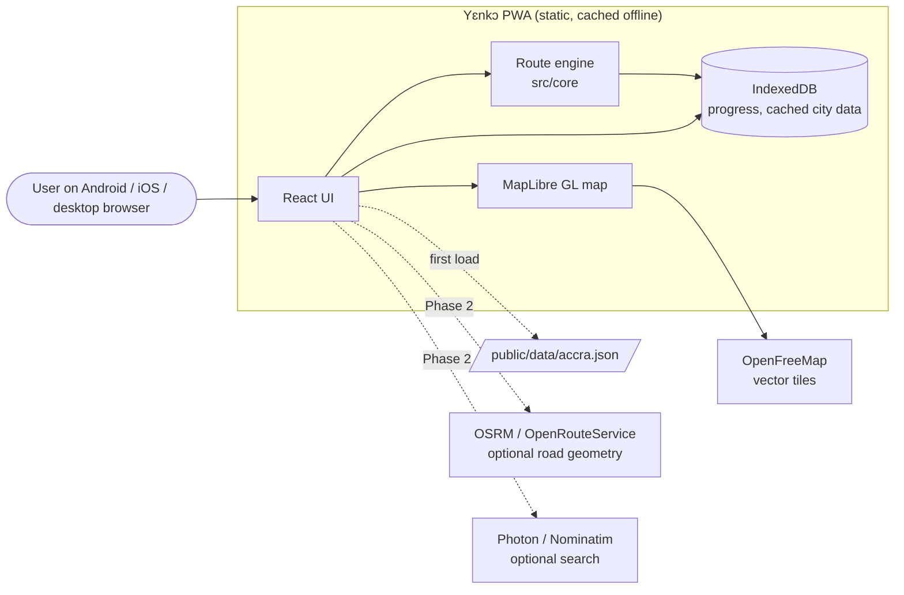
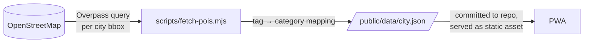
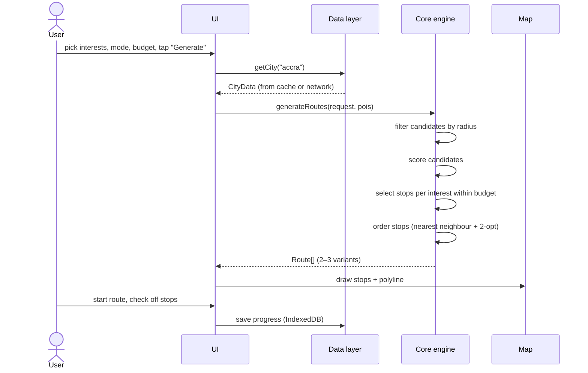
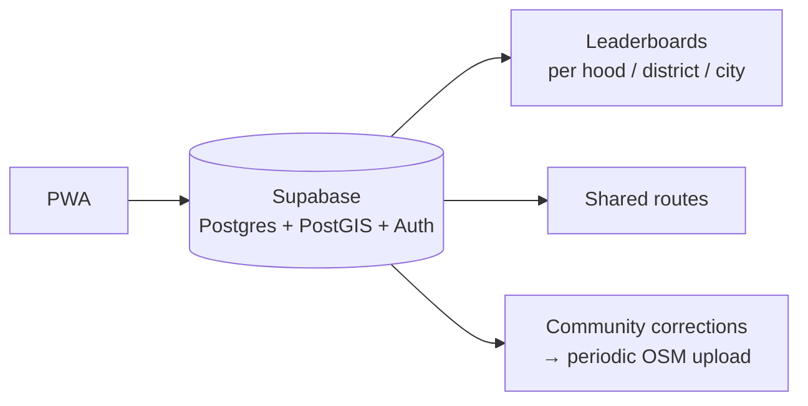

# Architecture

## One-paragraph version

Yɛnkɔ is a static progressive web app. A build-time script pulls points of
interest (POIs) for each supported Ghanaian city from OpenStreetMap into a JSON
file. At runtime the app loads the city file, caches it, and runs a pure
TypeScript route generator on the phone. The map is MapLibre with free vector
tiles. There is no server in the MVP. A backend is added in Phase 3 for
accounts, leaderboards and shared routes.

## System context

## Data pipeline (offline, run by a developer)

The JSON file is the contract between the data world and the app. Its shape
(`CityData` in `src/core/types.ts`) is deliberately boring: a list of POIs with
id, name, category, lat, lon and a handful of useful tags. Anything that
produces that shape (Overpass today, a Geofabrik extract tomorrow, a Supabase
table later) can feed the app without touching the engine.

## Runtime layers

| Layer | Folder | Depends on | Purpose |
|-------|--------|-----------|---------|
| Core | `src/core` | nothing | Types, geo maths, scoring, route generation. Pure functions, fully unit tested. |
| Data | `src/data` | core | Load a city file, cache it, filter by bounds, category registry. |
| Map | `src/map` | core, MapLibre | Render the map, stops and route lines. |
| UI | `src/ui` | all above, React | Screens: pick interests, see routes, walk a route, progress. |
| App | `src/App.tsx` | ui | Wiring and routing between screens. |

Dependency direction is strictly downward. The core never imports React.

## Route request flow

## Offline and low-data behaviour

- Service worker (`vite-plugin-pwa`) precaches the app shell.
- City JSON is cached on first load with a stale-while-revalidate strategy.
- Map tiles are cached by MapLibre's own tile cache for the session; whole-city
  offline tiles (PMTiles) are a Phase 3 feature.
- Route generation never needs the network.
- Progress is stored locally. Nothing is lost if the user is offline for a week.

## Phase 3 backend (sketch)

Row-level security keeps each user's progress private; leaderboards read from
a materialised view. Nothing about the PWA changes except that progress syncs.

## Non-goals (for now)

- Turn-by-turn voice navigation. Link out to Google Maps / OsmAnd for the
  "take me there" moment; we own discovery, not navigation.
- Real-time trotro tracking. Nobody has that data.
- Reviews and ratings. That is a different product with a moderation problem.
